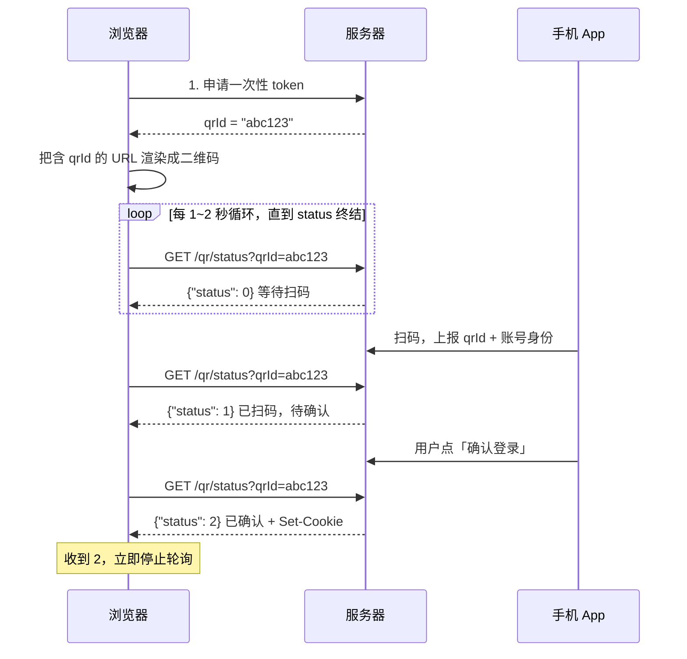

爬虫和反爬是一场成本对抗，不是谁绝对赢的问题。

服务端能看到的信号分为五层，下述所有方法都对应其中的一层或几层：

| 层次    | 服务端能看到什么           | 典型检测                       |
| ----- | ------------------ | -------------------------- |
| 网络层   | IP、ASN、地理位置        | IP频率、IP信誉库、机房IP识别          |
| 传输层   | TLS握手、HTTP/2帧参数    | JA3/JA4指纹、HTTP/2指纹         |
| 应用层   | Header、Cookie、请求参数 | UA校验、签名参数、动态Cookie         |
| 运行环境层 | JS能读到的浏览器属性        | webdriver检测、Canvas/WebGL指纹 |
| 行为层   | 鼠标、键盘、访问节奏         | 轨迹识别、验证码、访问模式分析            |
`一个爬虫方案在某一层伪装得再好，其他层露了horse feet还是会被识别`
## 爬虫方法
### 1. 直接 HTTP 请求
- 原理：不经过浏览器，直接构造HTTP请求拿到HTML或JSON文件，再解析内容
- 常用工具：requests、httpx、aiohttp、Scrapy，解析用 lxml、BeautifulSoup、parsel
- 优点：速度快，容易并发，占用资源小
- 局限
	- 不能执行JS，前端渲染的页面拿不到数据（Vue/ReAct SPA）
	- 遇到加密参数时，得先做JS逆向
	- ==TLS指纹、HTTP/2 指纹和浏览器不一样，容易被JA3识别==
- 操作：打开开发者工具的Network面板找数据接口（Fetch/XHR）。因为很多页面的数据来自一个JSON接口
### 2. 抓包找 XHR 接口
- 原理：现代很多站点是SPA（服务器返回HTML框架+JS文件），页面只是壳，真实数据走XHR/fetch 返回JSON
- 局限性：带 `sign` / `token` / `_signature` 时会失效
### 3. 自动化浏览器(Selenium/Playright/Puppeteer)
- 原理：Selenium走 ==W3C WebDriver 协议==，调用链：脚本 → WebDriver → 浏览器，脚本发出“点击、输入、跳转”这类指令，由真实浏览器执行，**JS渲染、Cookie生成、加密参数计算**都由浏览器自己完成；Playright/Puppeteer走 CDP 或类似协议，不过速度和可控性通常比 Selenium 好
- 优点：不需要分析加密逻辑，所见即所得；能处理复杂的前端渲染和交互流程
- 局限
	- 自动化特征明显；所执行的操作由驱动合成，易被识别
	- 性能差：每个实例都是一个完整的浏览器，**占内存、速度慢，并发能力低**
	- 稳定性一般：页面结构变化、加载时机不对等都会导致失败
### 4. CDP（Chrome调试协议）+ 模拟操作
- 原理：通过==WebSocket==和浏览器直接通信。主要能力根据不同的模块分为以下几类：
	- Network：监听、拦截、修改所有请求和响应，可直接拿到接口返回的JSON
	- Runtime：在页面上下文里执行JS
	- Input：派发鼠标和键盘事件
	- Page：在页面脚本执行前注入代码，常用来提前Hook
- 和Selenium的区别：不经过WebDriver层（能降低自动化识别的概率）；可以直接监听网络层，不用解析DOM
- 局限
	- 部分行为还是能被识别到
	- 只有chromium系列的浏览器适用
	- 资源消耗和浏览器自动化一样大
### 5. JS 逆向
- 原理：网站用前端JS生成加密参数（sign、token、X-Bogus 一类签名）或动态Cookie，服务端校验通过后才会返回数据，JS逆向即找到并破解这个加密逻辑，然后在浏览器外面复现出来，这样就可以用HTTP请求获取数据
- 一般流程（这部分我还不了解，只是复述ai讲的）：
	1. 定位：：Network 面板的 Initiator 调用栈、XHR/Fetch 断点、全局搜索参数名、Hook 关键函数（`JSON.stringify`、`XMLHttpRequest.prototype.send`、`document.cookie` 的 `setter`）
	2. 分析：混淆代码先做反混淆，常用 Babel 解析 AST 后还原字符串、展开控制流。然后识别算法，常见的是 MD5、SHA、HMAC、AES、RSA，或者自定义算法
	3. 复现
		- 用python重写性能算法，性能最好
		- 用 execjs 或 Node.js 直接执行扣下来的 JS
		- 补环境：JS 依赖 window、navigator、document 这些对象时，在 Node 里伪造出来
- 优点：一旦破解，速度和真实请求一样；资源占用低
- 局限
	- 门槛高，耗时长，遇到 JSVMP（把 JS 编译成自定义字节码再解释执行）时难度会大很多
	- 维护成本高（网站换了加密逻辑就得重新破解）
	- 补环境很难补全
### 6. 按键精灵：操作系统级的输入模拟
- 原理：在操作系统层面模拟鼠标和键盘，再配合截图和图像识别（找色、找图、OCR）判断屏幕状态
- 优点：浏览器完全正常，没有WebDriver痕迹；各种Web都能用，没有限制
- 局限
	- 效率极低，同一时间一台机器只能操作一个窗口，基本没办法并发
	- 依赖屏幕坐标和分辨率，界面变化会失效
	- 拿到的是像素，不是结构化数据，还要用OCR或其他方法提取
	- 行为特征容易暴露（因为操作流程固定）
### 7. 移动APP采集
- 原理：APP的数据一般也走HTTP(S)接口，只是请求从客户端发出
- 方法（这部分也不了解，仅复述ai讲的）
	- 抓包：把手机代理指向电脑，再安装证书解密HTTPS
	- 证书固定（SSL Pinning）：App只信任内置证书，抓包会失败。可能的方法：用工具在运行时Hook掉校验逻辑
	- 逆向
	- 自动化：用工具控制App界面（原理类似Selenium）
- 局限：Android 7 以后默认不信任用户证书，还要面对加固（加壳）、Root 检测、模拟器检测、native 层混淆，门槛比 Web 高
### 8. 非HTTP协议的网站和应用
- WebSocket：实时数据（如弹幕）。浏览器的Network面板WS标签可以看到帧的内容
- 私有TCP/UDP协议
## 反爬机制
### 1. 请求特征（Header / UA / Referer）校验
- 原理：检查请求头是否像像真浏览器发出的
- 检测点
	- User-Agent缺失
	- Referer缺失或不合理
	- 请求头之间互相矛盾
	- 请求头的顺序和真实浏览器不一样
	- 没有携带首页下发的Cookie，直接访问内页
- 应对：补全头部、保持字段顺序，先访问首页拿到Cookie，再访问内页
- 局限：最弱的一层，单独使用效果差
### 2. IP风控
- 原理：IP是客户端唯一无法伪造的（TCP连接需要完成握手）
- 检测点
	- 频率：单个 IP 在单位时间内的请求数超过阈值
	- 信誉：IP 是否在已知代理、机房、Tor 出口节点的名单里，可以通过 ASN 和第三方 IP 信誉库查询
	- 一致性：：IP 的地理位置和账号常用地、浏览器时区、语言是否一致
-  处置方式：限流、返回验证码、返回假数据、临时或永久封禁
- 应对：代理IP池
- 局限：误伤问题。移动网络和校园网大量用户共享同一个出口 IP，按 IP 严格封禁会误封真实用户，所以网站一般不会只靠 IP 判定
### 3. TLS指纹与HTTP/2 指纹
`（没学过计网，先按ai给的了解一下）`
- 原理：HTTPS 连接开始时，客户端会发送 ClientHello 消息，里面包含 TLS 版本、支持的加密套件列表、扩展列表、椭圆曲线等参数。不同客户端（Chrome、Firefox、Python、Go、curl）用的 TLS 库不同，这些参数的组合和顺序也不同，可以哈希成一个指纹
- 检测：请求头和TLS不一致就会被判定为伪装
- 应对：使用能模拟浏览器 TLS 握手的库，或直接用真实浏览器发请求
### 4. 浏览器环境检测
 原理：页面里的 JS 可以读取大量浏览器属性，用来判断是不是自动化环境，或者给设备生成唯一指纹
### 5. 行为识别
- 原理：机器操作和人操作在统计特征上有差别。网站在前端采集事件数据，交给后端的规则引擎或机器学习模型打分
- 常用特征量：速度、加速度、曲率、抖动幅度、停顿次数、事件采样密度
### 6. 验证码
验证码的设计目标是“对人容易，对机器难”，现在很多验证码是根据“答案+行为轨迹+环境指纹”等综合评定

### 7. 二维码登录
- 原理：
	1. 浏览器向服务器申请一个一次性token（不同的网页有不同写法，如uuid、ticket、qrId等），把包含该token的URL编码成二维码显示出来
	2. 浏览器开始轮询这个token的状态：等待扫码、已扫码、已确认、已过期
	3. 用户用手机扫码登录 → App把“这个 token 由某账号确认"告诉服务器
	4. 浏览器轮询到“已确认”后，服务器下发登录Cookie
（这里的token指服务器临时生成的一串随机字符）
- 局限：token的有效期很短，且需要按顺序轮询状态
图示整个过程：

注：token状态的变化：服务器生成 token 后，会在自己的存储里建一条记录，例如：
```
token: a3f9c2e8-...
状态:  等待扫码
账号:  （空）
过期:  120 秒后
```
这条记录会随着用户的操作变化（状态的变化）
### 8. 禁止复制
- 实现方式：
	1. 纯CSS：`user-select:none`，无法选中文字，这种情况没办法用Hook解决
	2. JS事件拦截：监听copy、selectstart、contextmenu（右键）、keydown（Ctrl+C），调用`preventDefault`阻止
	3. 篡改剪贴板：监听copy事件，用 clipboardData.setData() 把内容替换掉或追加版权声明
- 应对：
	- 在developer tools中禁用JS，或在Elements面板删掉对应的CSS规则和事件监听器
	- Hook：在页面脚本执行前注入代码
### 9. 字体反爬
`（没学过，先根据ai说的简单了解一下）`
- 原理：网页可以用 CSS 的 `@font-face` 加载网站自己的字体文件，字体文件里有两张表：
	- cmap 表：字符编码 → 字形名称
	- glyf 表：字形名称 → 实际画出来的轮廓
即网站在HTML里写的不是真正的字，而是Unicode 私有区里没有含义的编码，例如：页面上看到的是“5”，源码、剪切板里得到的是方框或乱码
- 有静态字体和动态字体两种
### 10. 参数签名、动态Cookie与响应加密
**这类是JS逆向主要对付的情况**
- 参数签名：请求里带timestamp时间戳、nonce随机数、sign签名。
`签名一般是把请求参数、时间戳、一段密钥拼起来再做哈希`
- 动态Cookie：浏览器第一次向服务器发起请求时服务器不返回内容，而是返回状态码和一段混淆过的JS，浏览器执行这段JS，采集环境信息并计算出一个Cookie，浏览器带着这个Cookie再次请求才能拿到真正的内容。Cookie很快会过期，且计算过程中混入了环境检测，在Node里直接运行这段JS可能会因为环境不对算出错误的值
- 响应加密：接口返回的不是明文JSON，而是一段密文，需要由前端JS用算法解密拿到真正的内容（应对：在JS里找到解密函数和密文）
- 这类反爬方法的局限性：因为签名和解密都在客户端完成，算法和密钥必然随JS下发到客户端（所以这类方法只能抬高逆向成本、缩短方案有效期）
### 11. JS混淆与反调试
- JS混淆目的：让10中的算法难以阅读和定位
- 反调试：阻止打开developer tools进行调试
### 12. 蜜罐与数据投毒
- 蜜罐：设置真人看不到、只有机器会访问的陷阱
-  数据投毒：识别出爬虫后不封禁，而是返回看起来正常但内容错误的数据
## 附：术语解释
1. **Hook**：在目标函数执行前或执行后插入自己的代码，用于观察或修改参数和返回值
2. 代理（Proxy）：在客户端和目标服务器之间转发请求的中间服务器。分为正向代理和反向代理
	- 正向代理：替客户端发请求
	- 反向代理：替服务器接请求，如Nginx、CDN
3. 抓包：**截获并查看**客户端和服务器之间传输的**数据**，分为两类：
	- 应用层抓包：看http请求和响应
	- 网络层抓包：看原始TCP/UDP数据包，用于分析非HTTP协议
4. ASN（自治系统号）：互联网上有很多“自治系统”，一个自治系统是一个运营商或大型公司管理的一组IP段，ASN是它的编号。阿里云、腾讯云、电信等都有自己的ASN
在反爬中，==网站通过IP查到ASN，就能判断这个IP属于云厂商机房还是家庭带宽==
5. DOM（Document Object Model，文件对象模型）：浏览器把HTML解析成的**树形结构**，每个标签、属性、文本都是树上的一个节点
6. W3C WebDriver协议：一项由W3C制定的**浏览器自动化标准**，它规定了自动化程序如何向浏览器发送命令（如打开网页、查找元素、点击按钮、输入文本、读取页面信息），可理解为一套“远程控制浏览器的通用接口规范”
7. WebSocket：一种网络通信协议
### 支撑资源
#### 1. 代理IP池
原理：反爬最基础的方法是根据 IP 访问频率，单个IP的请求太多可能会被封，而代理池让请求分散到大量IP上，单个IP的频率就会降低

IP类型（伪装由弱到强）：

| 类型   | 来源       | 特点                      |
| ---- | -------- | ----------------------- |
| 机房IP | 云服务器、IDC | 便宜、快，ASN一查就知道是机房，最容易被识别 |
| 住宅IP | 家庭宽带     | 接近真实用户，价格高              |
| 移动IP | 4G/5G基站  | 很多用户共享同一出口，网站不敢轻易封      |
池子的组成：获取（购买或自建）→ 可用性检测（连通性、延迟、匿名度）→ 打分（成功一次加分、失败一次扣分）→ 调度（按分数挑选，失效后剔除）→ 定期补充
#### 2. 账号池
原理：很多数据需要登录才能查看，而网站会按账号限频。账号池维护多个账号和它们的Cookie/Token，轮换使用
#### 3. 增量抓取
记录最后更新时间或内容哈希，只抓取有变化的部分